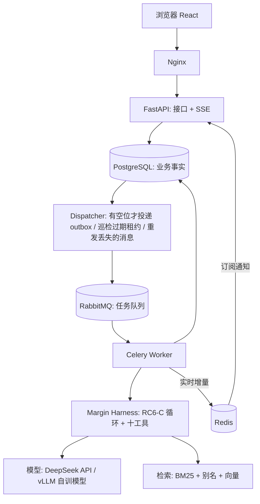

# Margin 后端计划

日期：2026-10-03。本文整合了此前三轮设计（`finetune/docs/development/20260917/01_AFAC后端技术栈与执行架构.md`、
ChatGPT 评审、`AFAC_Backend_Technical_Design.md` v2）以及 2026-10-03 的讨论结论。
**这是计划，不代表已经实现**；当前进度只看 [STATUS.md](../STATUS.md)。

---

## 1. 做什么

用户对固定的金融文档库（年报、债券募集说明书、保险条款等，573 个文档）提出跨文档、跨年度、
需要计算的问题。系统**异步**执行 Agent，**实时**展示它的思考和每一步工具调用，返回带原文出处的答案。

**要证明的能力**（对应校招 JD 里反复出现的要求）：

| JD 要求 | 本项目怎么体现 |
|---|---|
| 说明任务如何运行、失败后如何处理 | 任务状态机、Outbox、租约、取消、重试、故障测试 |
| Agent 观测与评测 | 每步思考/工具/耗时/token 可见；评测回放功能 |
| 多用户、限流、日志 | 登录、数据隔离、配额、模型并发控制、结构化日志 |
| FastAPI / PostgreSQL / Redis / 消息队列 | 主技术栈 |
| Harness 工程 | 自研 RC6-C Harness（笔记压缩、证据校验、错误恢复） |

**不做**：任意 PDF 上传与 OCR、多 Agent、联网搜索、微服务拆分、K8s、Kafka、答案缓存。

---

## 2. 技术栈：每个组件是什么、为什么用

| 组件 | 一句话解释 | 在本项目解决什么 | Java 生态对应 |
|---|---|---|---|
| **FastAPI** | Python 的 Web 接口框架 | 接收提问、查询任务、SSE 推送 | Spring Boot / Spring MVC |
| **Pydantic** | 数据校验 | 请求参数校验；工具参数校验 | Bean Validation + DTO |
| **PostgreSQL** | 关系数据库，系统的“账本” | 任务、步骤、事件、用户——唯一的事实来源 | MySQL |
| **SQLAlchemy 2.0** | ORM，用 Python 对象操作数据库 | 读写表、事务 | MyBatis / JPA |
| **Alembic** | 数据库表结构的版本管理 | 建表、改表都有迁移记录 | Flyway |
| **RabbitMQ** | 专门的消息队列（消息中转站） | Celery 的任务队列：原生消息确认、持久化、发送确认（D19，替代 M1 的 Redis 队列） | RabbitMQ（同） |
| **Redis** | 内存数据库 | ① 实时通知 ② 限流计数 ③ 缓存 | Redis（同） |
| **Celery** | 后台任务框架 | 一道题要跑几分钟，不能在 HTTP 请求里跑完 | RocketMQ 消费者 / XXL-JOB |
| **SSE** | 服务器单向推送（HTTP 长连接） | 前端实时看到 Agent 在干什么 | SseEmitter |
| **Nginx** | 反向代理（大门） | 前端静态文件 + 转发 `/api` + SSE 关闭缓冲 | Nginx（同） |
| **Docker Compose** | 一条命令启动所有服务 | 本地开发与演示部署 | 同 |
| **pytest** | 测试框架 | 单元 / 接口 / 集成测试 | JUnit + Mockito |
| **React + TS + Vite** | 前端 | 提问、任务列表、运行详情（时间线 + 证据） | — |

**为什么 Python 不用 Java**：Agent 岗主流语言是 Python，Harness 本身是 Python；用 Java 写后端等于两套语言加
一层 RPC，没有新东西可讲。面试时把上表的 Java 对应讲清楚即可。

**为什么 FastAPI 不用 Django**：Django 是全家桶（自带 ORM、后台、模板），以同步为主；FastAPI 只管 API，
原生异步，SSE 流式推送自然，Pydantic 与模型的结构化输出契合。代价是登录权限要自己写——这正好是要学的。

**明确不用的**：

| 不用 | 原因（面试时这样答） |
|---|---|
| Kafka | 它是可回放的日志流，适合每秒几十万条事件；本项目是少量长任务，要的是单条确认、重试、取消 |
| LangGraph | WeSeeker 项目已用过。本项目要讲“为什么手写”：需精确控制每步状态快照，并与训练轨迹对齐 |
| 微服务 / K8s | 单机固定语料，用不上；能说清“什么时候会拆（例如把检索拆成独立服务）”比真拆更有说服力 |

---

## 3. 架构



一句话：**数据库记账，队列解耦，租约防并发写，SSE 看过程。**

一个问题的生命周期：

1. `POST /runs`：在**一个事务**里写入 run、第一个 attempt、一条 outbox 记录，立即返回 202 和 run_id。
2. Dispatcher 在 worker 有空位时从 outbox 取出记录，往 RabbitMQ 队列发一条“请执行 attempt X”（收到发送确认才标记 sent；
   消息丢了由巡检重发，见 5.7、5.9）。
3. Worker 收到后先在数据库**领取租约**（条件更新），再跑 Harness；每完成一步，就把步骤、事件、断点在一个带 epoch 检查的事务里写库，
   提交后再往 Redis 发“有新事件”的通知。
4. 浏览器通过 SSE 订阅这个 run 的事件：持久事件从数据库按序号补读，思考 token 从 Redis 实时转发。
5. 终态（成功/失败/取消）写库后，SSE 发送终态事件并关闭。

---

## 4. 数据模型（首版）

| 表 | 关键字段 | 说明 |
|---|---|---|
| users | id, username, password_hash | 密码用 argon2 哈希 |
| sessions | id, user_id, token_digest, expires_at, revoked_at | 只存 token 的哈希；登出即吊销 |
| runs | id, owner_id, question, options, answer_format, status, cancel_requested, idempotency_key, model, created_at | `unique(owner_id, idempotency_key)` 防重复提交 |
| attempts | id, run_id, attempt_no, status, model, trigger, lease_owner, lease_epoch, lease_until, last_step, final, violation, error, started_at, finished_at（M4 加 checkpoint） | 一次执行尝试；重试（自动 / 用户“重新生成”）就新建一条，历史保留；接管不新建，epoch+1；checkpoint（JSONB）是断点 |
| steps | attempt_id, step_no, tool_name, arguments, result, reasoning, llm_ms, prompt_tokens, completion_tokens | `unique(attempt_id, step_no)` |
| events | run_id, seq, type, payload | `unique(run_id, seq)`，SSE 断线按 seq 补发 |
| outbox | id, attempt_id, status, next_attempt_at | 和业务写入同事务；部分唯一索引：同一 attempt 最多一条 pending |
| llm_calls（M5，原 M3） | attempt_id, step_no, model, duration_ms, first_token_ms, tokens | 轻量的观测数据，开发者视图用；M1 的耗时和 token 先记在 steps 上 |

---

## 5. 关键机制（面试重点）

### 5.1 Outbox：解决“写库成功但消息丢了”
直接“写库 + 发消息”两步走，中间崩溃就会出现“任务记下了却没人执行”。Outbox 把“要发的消息”
也写进同一个事务；Dispatcher 再异步投递，失败就重试。代价：可能重复投递 → 由 5.2 的租约去重。

### 5.2 租约 + epoch（fencing token）、接管与超时监督（2026-10-05 修订，D17）

完整推导和问答见 `review/03_架构对齐与租约方案.md`。M1 已实现：领取（只接受 pending）、带 epoch 的提交、续租线程、巡检（过期判失败并 epoch+1）、客户端超时、Celery 配置；接管、断点、监督者在 M4（D18）。要点：

- **领取 = 一条条件 UPDATE**（判断与修改在同一语句里，不“先查再写”）；“过期”只是 `lease_until < now()` 的比较，
  时间一律用数据库的 `now()`：
  ```sql
  UPDATE attempts SET status='running', lease_owner=:w, lease_epoch=lease_epoch+1,
         lease_until=now()+interval '90 seconds'
  WHERE id=:id AND (status='pending' OR (status='running' AND lease_until < now()))
  RETURNING lease_epoch;
  ```
- **每一步提交带 epoch**：同一事务里 `UPDATE attempts … WHERE lease_epoch=:my_epoch`（同时写断点、续租）
  + 写 steps + 写 events；更新 0 行说明已被取代 → 回滚并停止。
- **接管 vs 重试**：接管 = worker 出事，同一 attempt epoch+1，从最后一个已提交步骤之后继续（读断点），最多 3 次；
  重试 = 新建 attempt 从头开始，自动（执行失败，换备用模型，1 次）或手动（用户点“重新生成”，计入配额）。
- **Inspector**（在 dispatcher 进程里）每 15 秒：给租约过期的 running attempt、消息丢失的 pending attempt 补一条 outbox；
  outbox 部分唯一索引保证同一 attempt 最多一条 pending。
- **超时预算**：LLM 总 180s / 首块 60s / 块间 30s；检索 30s；单个工具 60s；整个 attempt 20 分钟。
- **监督者**（心跳线程）：每 5 秒检查超时与 epoch，每 15 秒续租；发现问题举起停止标志；
  60 秒无回应判定卡死 → `os._exit` 结束子进程，Celery 补新进程，任务由别人接管；Celery 硬时限 25 分钟只防整个进程冻住。
- **被取代的 worker**：续租 / 提交 / 主线程检查点任一处发现 epoch 不对就停止，不写任何东西；关闭 HTTP 流、回滚、
  释放模型并发名额（名额自带过期时间）。实时片段带 epoch，前端丢弃旧 epoch。
- **Celery 配置**：`acks_late=True` + `prefetch_multiplier=1`（每个槽位只拿正在跑的那一条）。M1.5 起用 RabbitMQ（见 5.7），推出去还没确认的消息不设时限：
  确认期限 `consumer_timeout` 从 RabbitMQ 4.3 起只有 quorum 队列检查，我们的经典队列上不生效，M1.6 删掉了这项配置
  （M1 用 Redis 时是 `visibility_timeout` 2 小时）；
  M1 一个 worker 容器 4 个子进程，扩容加容器。队列只是唤醒信号，谁执行由数据库决定。

### 5.3 幂等提交
前端每次提交生成一个 `Idempotency-Key`；同一个 key 重复提交返回同一个 run，参数不同则返回 409。

### 5.4 两层事件：可靠和实时兼得
| 层 | 内容 | 存储 | 断线后 |
|---|---|---|---|
| 持久事件 | 步骤开始/结束、完整思考、工具结果、终态 | PostgreSQL，带 seq | 按 seq 补发 |
| 瞬时增量 | 思考和回答的逐字 token | Redis pub/sub，不落库 | 不补发，该步结束后由完整文本覆盖 |

每个 token 都写库会造成严重写放大，所以只有“结果”进库，“过程”走 Redis。

**持久事件的“有新事件”通知：用 PG LISTEN / NOTIFY（D20，2026-10-06 定）**。现在每个 SSE 连接每秒查一次 events 表，
用户越多查询越多。改为：`add_event` 在同一事务里 `NOTIFY run_events, '<run_id>'`；
**每个 API 进程只开一条 LISTEN 连接**（不能每个 SSE 连接各开一条，会耗尽 PG 连接），收到后在内存里转给关注这个
run 的 SSE 连接，再由它们按 seq 查库。通知来自事务提交，不会出现“通知到了、事件还没提交”。
SSE 仍保留低频兜底查询（例如每 10 秒），防止错过通知（通知不持久，LISTEN 连接重连期间会丢）。
逐字片段仍走 Redis pub/sub：不落库、量大，NOTIFY 单条有 8KB 上限且会经过 PG。

**心跳与半死连接（M2 实现时补充，D22）**：SSE 空闲 10 秒发一个具名事件 `event: ping`（不带 id，不影响 Last-Event-ID）；
前端 25 秒什么都没收到就关掉连接、用 `?after=<最后的 seq>` 重建。原因：中间的代理不一定把断开传给浏览器
（M2 联调时 Vite 代理在 API 进程死掉后一直挂着浏览器侧连接），只靠 EventSource 的自动重连会永远等下去。

### 5.5 多用户
| 能力 | 做法 |
|---|---|
| 认证（你是谁） | 用户名密码登录 → 随机 session token 存 HttpOnly cookie，库里只存哈希 |
| 授权（你能看什么） | 所有查询都带 `owner_id`；访问别人的任务返回 404（不暴露是否存在） |
| 配额 | 每人同时最多 3 个运行中任务，每小时最多提交 20 个，超出返回 429 |
| 模型并发 | Redis + Lua 原子信号量，所有 worker 共享同一个模型并发上限，防止 429 风暴 |
| 状态隔离 | 每个任务独立的 Harness 状态，笔记和证据不会串 |

为什么用 Session 不用 JWT：浏览器的 EventSource（SSE）不能带自定义请求头，cookie 会自动带上；
Session 可以服务端随时吊销。

M3 的完整做法（2026-10-22 作者批准）见 5.10。和上表的差别：每人同时运行超过 3 道不拒绝，留在 outbox 排队；
重新生成也计入每小时的提交次数。

### 5.6 缓存（一个真实场景）（2026-10-22：挪到 M4.5，和检索服务一起做）
只缓存“证据原文查询”（cache-aside：先查 Redis，没有再查库并回填，带过期时间）。
**不缓存答案**：每次执行过程不同，缓存答案还会让人误以为结果被验证过。
借这个场景准备缓存穿透 / 击穿 / 雪崩的面试题。

### 5.7 队列切换到 RabbitMQ + 消息丢失对账（2026-10-06，D19）

**问题（M1 review 发现）**：dispatcher 把消息发出去、outbox 标成 sent 之后，如果消息在消息中转站里丢了
（Redis 重启、队列被清空），attempt 会永远停在 pending：没有 worker 收到消息，M1 的巡检只处理 running；
用户点“重新生成”也会因为“还有 pending 的执行”返回 409。这道题就永远卡住了。

**思路：两层。** 可靠的队列让消息尽量不丢；数据库对账保证丢了能补回来。PG 仍然是唯一的裁判，
补发出来的重复消息由 `claim` 挡住，所以补发猜错的代价只是一条多余的消息。

#### 第一层：RabbitMQ 配置（尽量不丢）

| 配置 | 值 | 为什么 |
|---|---|---|
| 发送确认 | Celery `broker_transport_options={"confirm_publish": True}` | RabbitMQ 回复“收到了”，dispatcher 才标记 sent；没收到确认就按现有的退避规则重发 |
| 队列 / 消息持久化 | 队列 durable、消息 persistent（Celery 用 RabbitMQ 时的默认值，保持不改） | RabbitMQ 重启后消息还在 |
| 数据卷 + 固定主机名 | `rabbitmqdata:/var/lib/rabbitmq`，`hostname: rabbitmq` | RabbitMQ 的数据目录按节点名（取自主机名）区分，主机名变了会“找不到”旧数据 |
| 确认期限 `consumer_timeout` | ~~1 小时~~ 不配（M1.6 删除） | 原以为超时会关闭整个通道、所有待确认消息回队列，所以要大于硬时限 25 分钟。实际 RabbitMQ 4.3 起只有 quorum 队列检查确认期限（而且只放回超时的那条），我们的经典队列上不生效；未确认的消息没有时限，由 Celery 硬时限和租约收场（D28） |
| 确认时机与预取 | 保留 `task_acks_late=True`、`worker_prefetch_multiplier=1` | 执行完才确认；每个子进程手上只有正在执行的一条 |
| Redis 专用配置 | 删除 `visibility_timeout` | RabbitMQ 有原生确认，不需要模拟 |

#### 第二层：巡检对账 `requeue_lost`（dispatcher 每 15 秒，和 `expire_leases` 同一轮）

> **M1.6 已改**：这一节是 M1.5 的设计。M1.6 改成有空位才发 + 只看时间的重发（`resend_lost`），水位线、兜底、宽限期都已删掉，巡检间隔改为 10 秒，见 5.9。

**候选**：attempt 是 pending、outbox 是 sent、投递已经超过**宽限期 2 分钟**。
宽限期吸收两件事：几个子进程同时取消息时领取顺序的毫秒级抖动；子进程处理第一个任务前要加载语料和 BM25
（有缓存约 2 秒，缓存丢失时要重建，更久，这种情况误判只会多一条消息）。

**判定**：候选满足下面任意一条，就认为消息丢了：

| 规则 | 条件 | 适用场景 |
|---|---|---|
| ① 水位线 | 存在**比我晚投递**、且已经被领取（attempt 不是 pending）的任务 | 有流量时的主规则。队列先进先出，后面的都被领走了，我还在等，说明我的消息丢了；流量越大发现越快 |
| ② 队列为空 | RabbitMQ 里就绪消息数 = 0 | 没有流量时水位线不动，靠这一条 |
| ③ 兜底 | 投递已经超过 30 分钟 | 前两条都判断不了时（例如查不到队列状态） |

“就绪消息数”和“消费者数”用被动声明队列取得（`queue_declare(passive=True)`，只读，不改队列）。
它只统计就绪消息，不含待确认的；正在执行的任务处于待确认状态，对应的 attempt 已经是 running，
所以“队列为空 + 仍是 pending”只可能是丢了。查不到队列状态（RabbitMQ 连不上）时跳过规则 ②。
**消费者数为 0 时不补发**：没有 worker 在线，补发也没人收，这是“worker 全挂了”，交给告警处理。

**动作**：

```sql
-- 补发：复用同一行 outbox，改回 pending，下一秒 dispatch_once 就会投递
UPDATE outbox SET status='pending', next_attempt_at=now(), redeliveries=redeliveries+1
WHERE id=:id AND status='sent';
```

- 复用同一行：outbox 上“同一个 attempt 最多一条 pending”的部分唯一索引仍然成立；重新投递时 `sent_at` 会更新，
  这条消息重新排到队尾，水位线按新时间计算。
- **补发上限 3 次**：第 4 次判定丢失时不再补发，改为把 attempt 判失败
  （`UPDATE attempts SET status='failed', error='delivery_lost', lease_epoch=lease_epoch+1 WHERE id=:id AND status='pending'`，
  同一事务里 run 判失败、写 `attempt_failed` 事件）。用户可以点“重新生成”，同时触发告警。
- 并发安全：所有更新都带状态条件。巡检判定的同时如果 worker 刚好领取了，attempt 已经是 running，
  判失败那条更新 0 行；补发出去的那条消息到了 worker 手里，也会被 `claim` 挡住。
- 每次补发记一条 warning 日志，并计数（M6 接到监控，“补发次数 > 0”就告警：说明消息中转站出了问题）。

**查询**（水位线只看最近 1 小时，避免扫全表）：

```sql
-- 候选：数量很少
SELECT o.id, o.attempt_id, o.sent_at, o.redeliveries
FROM outbox o JOIN attempts a ON a.id = o.attempt_id
WHERE o.status = 'sent' AND a.status = 'pending' AND o.sent_at < now() - interval '2 minutes';

-- 水位线：已被领取的任务里最晚的投递时间
SELECT max(o.sent_at)
FROM outbox o JOIN attempts a ON a.id = o.attempt_id
WHERE o.status = 'sent' AND a.started_at IS NOT NULL AND o.sent_at > now() - interval '1 hour';
-- （实现时把原来的 a.status <> 'pending' 改成 started_at：判为 delivery_lost 的不算“已被领取”，D21）
-- 候选 sent_at < 水位线  →  规则 ① 成立
```

**表结构（迁移 0002）**：outbox 加 `redeliveries int not null default 0`（补发次数；不复用 `tries`，
`tries` 是投递失败次数，用来算退避时间）；加部分索引 `outbox(sent_at) WHERE status='sent'`，供水位线查询使用。

**前提与限制**：水位线依赖“同一个队列 + 先进先出”。以后加优先级队列或拆成多个队列，要按队列分别计算水位线。

#### 测试（集成测试，真实 PG；队列状态作为参数传入，不依赖 RabbitMQ）

1. 比我晚投递的任务已被领取、我仍 pending 且超过宽限期 → outbox 回到 pending，补发次数为 1
2. 宽限期内（1 分钟前投递），即使水位线已越过也不补发（领取顺序抖动）
3. 队列为空、pending 超过宽限期 → 补发
4. 队列不空、水位线未越过、不到 30 分钟 → 不补发（正常排队）
5. 已补发 3 次仍判定丢失 → attempt 判为 `delivery_lost` 失败、epoch + 1，之后可以重新生成
6. 消费者数为 0 → 不补发
7. （改造现有测试）RabbitMQ 连不上、或拒收（没有确认）时，outbox 保持 pending 并退避

#### 切换步骤（M1.5）

1. compose：新增 `rabbitmq` 服务（`rabbitmq:4-management-alpine`，5672 + 管理界面 15672 只绑 127.0.0.1，
   数据卷、固定主机名、健康检查 `rabbitmq-diagnostics -q ping`、`consumer_timeout` 配置文件（M1.6 删除，不生效））；
   worker、dispatcher 依赖它健康后再启动。
2. 配置：新增 `MARGIN_BROKER_URL`（`amqp://...`），写进 `.env.example`；compose 里覆盖成容器内地址。
3. `worker.py`：broker 改用新配置；删掉 `visibility_timeout`。发送确认实际开在 dispatcher 自己的 publisher 上（D21）。
4. `dispatcher.py`：投递失败的异常范围加上“拒收 / 未确认”；新增 `requeue_lost` 和读取队列状态的函数，巡检时调用。
5. 迁移 0002 + `models.py`。
6. 依赖：`celery[redis]` 改为 `celery`（RabbitMQ 客户端是 Celery 的默认依赖）；Redis 客户端到 M2 做推流时再加。
7. 文档：D19、本节、README 和 `review/01_运行链路.md` 里的队列描述。
8. dispatcher 改为 LISTEN / NOTIFY 唤醒，见下一小节。

#### dispatcher 用 LISTEN / NOTIFY 唤醒（代替每秒轮询）

现在 `main()` 每轮 `time.sleep(1)` 后扫一次 outbox：空闲时每秒白查一次，有新任务时最多晚 1 秒才投递。

- **发通知**：在写 outbox 的事务里执行 `NOTIFY outbox`。共两处：`runs._enqueue_attempt`（新任务），
  和 `requeue_lost`（对账时把 outbox 改回 pending）。NOTIFY 是跟着事务走的：提交后才真正发出，回滚则取消，
  所以 dispatcher 被叫醒时那一行一定已经能查到。同一事务里的多次相同通知会合并成一条。
- **收通知**：dispatcher 另开一条**专用的自动提交连接**执行 `LISTEN outbox`（LISTEN 要求连接不在未提交的事务里，
  所以不从连接池里借）；`time.sleep(1)` 改成用 psycopg 3 的 `notifies(timeout=...)` 等通知。
- **定时扫描保留作兜底**：等待的上限 = min(距离最早一条退避记录到期还有多久, 10 秒)。
  通知只负责“有新任务”，退避到期的重试、dispatcher 重启期间错过的通知（通知不持久，没人在听就丢了）都靠兜底扫描。
- 15 秒一次的巡检（`expire_leases`、`requeue_lost`）不变。
- 专用连接断开（PG 重启）时直接退出进程，由 compose 的 restart 策略拉起，和现在“数据库出错就退出”的策略一致。
- **测试**：提交一个任务后，dispatcher 在 1 秒内（不靠兜底扫描）就把它投递出去；
  事务回滚时不会收到通知、也不会投递。

---

### 5.8 回答形态：从“考试答案”到“带出处的回答”（M2.5，2026-10-06 作者批准，D23）

**问题**：Harness 是按比赛题打磨的。`finalize` 只交一个规范化的短答案（`["1204.63"]`、`["ABC"]`），不写成段的回答，
也不和引用关联；`cite` 是可选的（系统提示词：“cite 不是 finalize 的机械前置条件”），模型可以零引用就交答案（M2 联调 run 31）。
设计稿 `web/design/preview.html` 里的回答（大号结论 + 带 [1][2] 的段落 + 口径说明）是手写的示例，现在的系统产生不出来。
另外，答案格式要用户手选、左栏显示的是问题原句，都不像产品。

**目标**：做出设计稿那样的回答，并且：

- **不改模型接口**：系统提示词、十个工具的说明一个字不改（自训模型在这套接口下训练，见 AGENTS.md）；
- **不破坏评测**：E80 回放（M5）仍按 `finalize` 的短答案打分；
- **只用一个模型**：新增的两次调用都用这道题执行 Harness 的同一个模型（`runs.model`），各自独立的提示词，不维护第二个模型。

**整体流程**（worker 里，一次执行内，全部在租约保护下）：

```text
领取 attempt
  -> ① 理解题目（第 1 次执行才做）：同一个模型，独立提示词 -> 标题、结论说明、答案格式
  -> ② Harness（原样）：检索、阅读、引用、计算、finalize；产品模式下没引用会被提醒一次
  -> ③ 撰写回答：同一个模型，独立提示词，输入是“已校验的证据” -> 带 [n] 的回答，流式推给前端
  -> 代码校验回答（[n] 合法、数字有出处）-> 写库 -> 结束
```

#### 第 0 步：先做实验，按结果定细节

下面 ①②③ 的细节都是假设，实验结果可能推翻它们。实验用手动运行的脚本（和 `scripts/run_episode.py` 同类，不进测试），
结果先在对话里汇报给作者，确认后记进 STATUS，再写正式代码。

**只用 DeepSeek 做实验**（学校网关的主用模型）：实验室服务器在跑 27B 实验，自训模型等服务器空出来后再按同样的脚本复测；
GLM 不再单独跑。

| 实验 | 做法 | 回答什么问题 | 通过标准 |
|---|---|---|---|
| E1 现状摸底 | 现有系统跑 5 道开放问题（“文本”格式）+ 5 道数值题 | 开放问题模型交什么、引不引用、笔记里有什么 | 只是摸底，没有标准；结论决定 ③ 的输入 |
| E2 撰写回答原型 | 拿 E1 和历史 run（14、16、32）的步骤，离线调用 ③ 的草稿提示词；比较两种输入：(a) 笔记 + 引用 + 计算结果，(b) 再加每步的完整思考 | 写得好不好、会不会编、多慢 | 校验后 [n] 全部合法；抽查 10 篇没有编造的数字；耗时中位数 < 15 秒 |
| E3 引用提醒 | E80 抽 20 题，产品模式的引用提醒开 / 关各跑一遍 | 提醒会不会让答题变差、变慢 | 答对数不少于关闭时减 1；平均多出的调用 ≤ 2 次 |
| E4 理解题目 | E80 全部 80 题（去掉选项、只给题干）+ 10 道开放问题 | 格式判断准不准、标题能不能用、多慢 | 格式判断与题集标注一致 ≥ 90%（数值 / 百分比 / 日期 / 判断 / 文本五类）；耗时中位数 < 5 秒 |
| E5 一次交齐 | 另写一份“新版 finalize”工具说明（交答案时同时交带 [n] 的回答正文），放在实验脚本里，不动 `harness/prompts/`；E1 的 10 题跑一遍，和“finalize + ③ 撰写”比较 | 不经训练的模型能不能一次交齐；为以后的 RL 定目标 | 只是对照，不直接上线；回答质量、合法 [n] 比例、总耗时与 ③ 并列汇报 |

#### 实验结果（2026-10-06，DeepSeek，脚本 `scripts/experiments/m25/`）

| 实验 | 结果 | 结论 |
|---|---|---|
| E1 | 数值题 4/5；10 题都调用了 cite；10 题里只写过 1 次笔记；开放问题交的是一串短句（open03 跑了 22 步、352 秒，只交了一个短语） | 开放问题需要撰写回答 |
| E2 | 13 篇：非法 [n] 0、未核实数字 0（输入 a），耗时中位数 14.7 秒；输入 b（加完整思考）输入多 4 倍、1 篇有未核实数字 | 达标，用输入 a；提示词加“不提内部材料名” |
| E3 | 关 15/19（1 题网关失败）、开 16/20，同一批题都是 15/19；只有 1 题被提醒，补引用后答对 | 准确率不降；调用数差异来自模型自身波动 |
| E4 | 格式一致 83/90，去掉题集标注错误和“问多个数字”后约 89/90；标题可用；耗时中位数 5.7 秒 | 准确率达标；和 Harness 并行，不让用户等 |
| E5 | 9/10 交了回答正文，非法 [n] 0，2 题有未核实数字，1 题用完轮数 | 不上线，作为以后 RL 的目标 |

#### ① 理解题目

- **时机**：worker 领取后，和 Harness 同时开始（另一个线程），不让用户等它（E4 中位数 5.7 秒）；
  答案格式只在 finalize 规范化时才用到，Harness 交答案前等它结束。只在第 1 次执行且 `runs.title` 为空时做，“重新生成”沿用。
  调用方已经给了答案格式（评测回放）时跳过格式判断。
- **提示词**：新文件 `src/margin/prompts/understand.txt`，不放进 `harness/prompts/`（那里是模型接口）。
- **输出**（JSON，用 Pydantic 校验）：
  - `title`：左栏和标题栏显示的提纲，20 字以内，例如“广晟控股 2022 年营业收入”；
  - `label`：结论行旁边的说明，例如“广晟控股 · 2022 年营业收入（亿元）”（设计稿的 `verdict-label`）；
  - `answer_format`：`num` / `pct` / `date` / `tf` / `text` 五选一。真实用户不会给选项，所以不出现 `mcq` / `multi` / `rank`；
    调用方带了选项（评测）时由调用方指定格式。
- **失败处理**：网关报错或 JSON 不合格，不让这道题失败：标题取问题前 20 字，格式按 `text`，记一条日志。
- **存储**：迁移 0004（0003 已用于给旧 step 事件补引用编号）：`runs` 加 `title`、`answer_label`（可空）；`answer_format` 改为可空（空 = 自动，理解后回填）。
  写库带 epoch 校验（和 `commit_step` 一样），同一事务写持久事件 `run_understood {title, label, answer_format}`，刷新页面也能恢复。
- **接口**：`POST /runs` 的 `answer_format` 改为可选；`options` 保留（只给评测用，前端不再提供）；`GET /runs` 返回 `title`（为空时用问题原句）。

#### ② 产品模式：提醒一次引用，第二次照收

- 规则：“提醒一次、第二次照收、页面标出无引用”。不硬性要求，避免模型找不到可引用原文时被卡死、用户什么都看不到。
- `finalize` 的校验代码里加一条，和现有的“没搜索过不能交”（`search_required`）同一种做法：
  任务带 `require_citation=True`、`state.citations` 为空、且这次执行还没提醒过时，返回工具错误
  `citation_required`（“提交前建议用 cite 引用支持结论的原文；如确实没有可引用的原文，可再次提交”）。
  模型第二次提交（不管补没补引用）都照收；没有引用时这次执行标记 `uncited`，页面在回答上方标“本回答没有引用原文”。
- 只提醒一次，所以不会触发 `repeated_tool_error`（同一错误 3 次才停）。
- 产品提交默认打开；评测回放、自训模型对照实验关闭。工具说明和系统提示词不变，变的只是产品模式下多一种工具错误，记在 D23。
- `escalate`（证据不足、放弃作答）不受影响。

#### ③ 撰写回答

- **时机**：Harness 正常结束（finalize 或 escalate）之后、写“执行结束”之前，仍在租约内；前端过程区显示“正在撰写回答”。
- **引用编号移到后端**：现在是前端 `citations.ts` 给引用编号。③ 写的 [n] 必须和前端的来源卡片是同一套编号，
  所以编号规则（只取通过校验的、去重、按出现顺序）移到后端，结果随事件下发，前端不再自己编号。
- **输入**（E2 定为输入 a）：问题、`label`、答案格式、短答案（或 escalate 的原因）、编号好的引用原文（带前后文）、计算步骤（公式 = 结果）、
  最新的工作笔记。不放每一步的完整思考（输入多 4 倍，数字反而更容易出错）。
- **输出约定**（纯文本，便于流式）：
  - 第一段：一句话结论；
  - 中间：支撑段落，事实后面紧跟 `[n]`；
  - 最后（可选）：以“口径说明：”开头的一段，例如 run 14 的“营业收入 vs 营业总收入”；
  - escalate 时写“缺什么、为什么答不了”，不硬答。
- **代码校验**（写库之前）：
  - 不存在的 `[n]` 直接删掉并记日志；
  - 回答里的数字必须出现在引用原文、计算结果、短答案或问题里，找不到的记为“未核实数字”，存下来、页面上轻提示，并作为评测指标；
  - 一处引用都没有时（只可能是 escalate），回答里不允许出现 `[n]`。
- **流式**：沿用实时片段通道（Redis），`kind` 为 `answer`，前端逐字显示；写完后持久事件 `answer_written {text, citations, unverified}`
  覆盖逐字片段（和思考片段同一套规则）。
- **存储**：放进 `attempts.final`（`final.written = {text, citations, unverified}`），不加列。
- **失败处理**：③ 出错（网关报错、超时）不让这道题失败：照常结束，页面退回现在的样子（短答案 + 依据列表），并提示“回答生成失败，可重新生成”。

#### 前端

- **输入框**：只剩一个文本框，去掉答案格式和四个选项框。
- **左栏、标题栏**：显示 `title`；理解完成前先显示问题原句。
- **时间线**：第一项“理解题目”（标题、判断的格式），最后一项“撰写回答”。
- **回答区**：按设计稿结构——
  - 数值 / 百分比 / 日期 / 判断：大号结论 + `label`；开放问题（`text`）不显示大号结论；
  - 回答正文逐字出现，`[n]` 可点，悬停时画连线到右侧旁注（和 A 一起做）；
  - “口径说明”单独一段，小号灰字；
  - 底部账目行：模型、步数、引用数、耗时；复制、重新生成按钮。
- **右侧旁注**：执行结束后只对齐回答正文里的 `[n]`（M2 补完 A 已先对齐到依据列表，这里换成正文里的锚点）。
- **无引用标记**：`uncited` 时回答上方一行小字“本回答没有引用原文”。

#### 测试

- 单元：理解结果的解析与失败退回；`citation_required` 只在产品模式出现、只提醒一次、第二次照收并标 `uncited`；回答校验（删非法 `[n]`、找出未核实数字）；后端引用编号。
- 集成（FakeLLM + 真实 PG）：事件顺序（`attempt_started` → `run_understood` → 步骤 → `answer_written` → `attempt_finished`）；
  ③ 失败时照常结束；重新生成沿用标题、不重新理解。
- 前端 vitest：时间线处理新事件；回答正文按 `[n]` 切分。
- 浏览器：开放问题、数值题各一道走完全程；撰写中途刷新（逐字片段丢掉、结束后由持久事件恢复）。

#### 不做的

- 多轮追问（要在 run 之上加“对话”，和 M3 的权限、配额一起设计）。
- 改正式的 `finalize` 参数让它直接带回答：E5 只做对照。一次交齐更好，但现在的模型没为此训练过，
  要靠后续专项 RL（数据怎么收集另出方案）；自训模型学会之后，再拿同一批题和本方案比较决定是否切换。

#### 提交拆分（草案）

| 提交 | 内容 |
|---|---|
| M2.5-0 ✅ | 实验 E1–E5 的脚本与结果（作者 10-06 确认） |
| M2.5-1 ✅ | 引用编号移到后端（事件带编号），前端改为使用后端编号 |
| M2.5-2 ✅ | 迁移 0004 + 理解题目（worker、事件、接口可选格式） |
| M2.5-3 ✅ | 产品模式的引用提醒（`citation_required` 提醒一次、`uncited` 标记） |
| M2.5-4 ✅ | 撰写回答（流式、校验、存储、失败退回） |
| M2.5-5 ✅ | 前端：输入框简化、标题、回答区按设计稿重做（作者试用后修订六次，见导读） |
| M2.5-6 ✅ | 收尾：浏览器验证、导读总览、STATUS / DECISIONS |

**代价**：每道题多两次模型调用。按 E2、E4 的标准，大约多 5～20 秒，相对整道题 30～100 秒；M3 加模型并发信号量时，这两次调用一起计数。

### 5.9 投递与对账改造：有空位才发 + 只看时间的重发（M1.6，2026-10-13 作者批准，D28）

**问题（M1.5 review 发现，详见 `review/M1.5_监督机制梳理.html` Q17～Q26）**：

- 子进程收到消息后先加载语料（约 2 秒，BM25 缓存丢失时约 100 秒）再 claim。这段时间 PG 看不到任何迹象，
  对账只能靠水位线、队列为空这些“证据”去猜，猜不准时多发重复消息；
- 积压全在 RabbitMQ 里，“排队”和“丢了”分不清，所以要有 30 分钟兜底（规则 ③）。积压超过 30 分钟会误补发，
  约 2 小时误判失败；水位线还要求“一个队列 + 先进先出 + 额度等于子进程数”，以后加队列就要重新设计。

**思路**：让“发出”到“claim”只有几毫秒，并且 RabbitMQ 里不积压。这样“发出 1 分钟还没 claim”只可能是丢了，
对账只看时间就够，水位线、规则 ② 作为判定条件、规则 ③ 都可以删掉。

#### ① 先 claim 再加载（worker）

- `execute_attempt` 收到消息先 `claim`，再在续租线程（`LeaseKeeper`）的保护下加载语料；加载多久都有租约保着。
- `execute` 不再直接接收语料对象，改为接收加载函数（测试里传一个直接返回小语料的函数）。
- 代价：加载中子进程死了，attempt 已是 running，90 秒后判 `lease_expired`，要用户重新生成（M4 接管后自动接上），
  不再由对账自动补发；加载出错变成一次看得见的失败。
- 前端：执行中、还没有任何一步、也没收到实时片段时，过程区标题显示“正在准备资料…”（原来是“正在执行 · 已完成 0 步”），
  扫光动画不变。只改 `Work.tsx` 的 `label`，后端不加事件。

#### ② 有空位才发（dispatcher 投递）

- `dispatch_once` 每轮最多发 `空位` 条：`空位 = 消费者数 × 每个 worker 的子进程数 − 在途数`。
  - 在途数 = attempt 是 running 的条数 + attempt 是 pending 且 outbox 是 sent 的条数（已发出、还没结束），一条 SQL；
    running 走现有的部分索引 `ix_attempts_running_lease`。
  - 消费者数用最近一次巡检读到的队列状态（最多 10 秒前），不在每次投递时连 RabbitMQ。还没读到过、或读不到时，这一轮不发。
  - 每个 worker 的子进程数改成配置 `MARGIN_WORKER_CONCURRENCY`（默认 4）：compose 里 worker 的 `--concurrency`
    和 dispatcher 读同一个变量。
- 积压留在 outbox（pending），按 `outbox.id` 先进先出。M3 的“每个用户最多同时 N 道”“按用户轮流”只改这条 SQL 的排序和条件。
- **空出位子时叫醒 dispatcher**：attempt 结束的四处在同一事务里调用现有的 `notify_outbox`：
  `lease.finish`、`lease.fail`、`lease.expire_leases`、`dispatcher._fail_undelivered`。不加的话，空位要等最多 10 秒的兜底扫描。
- 已知的小代价：worker 容器被 kill 后，它手上 running 的 attempt 在租约过期前（约 100 秒）仍算在途，
  这段时间别的 worker 的空位会被少算。

#### ③ 只看时间的重发（dispatcher 巡检，替换 `requeue_lost` 的判定）

- **前提**（不满足就这一轮不判，10 秒后下一轮再看）：读得到 RabbitMQ 的队列状态；消费者数不为 0；**就绪数为 0**。
  有了 ②，就绪数正常时几乎总是 0；长时间不为 0 说明出了别的问题（子进程数配错、RabbitMQ 刚重启、worker 卡住），
  这时暂停重发，避免误判排队的消息。就绪数连续 2 分钟不为 0 记一条 warning 日志（M6 接告警）。
- **判定**：attempt 是 pending、outbox 是 sent，且 `sent_at < now() - 1 分钟 × 2^redeliveries`。
  即第一次发出 1 分钟后重发，之后间隔 2、4 分钟；第 3 次重发后再过 8 分钟还没 claim，判 `delivery_lost`
  （从第一次发出算约 15 分钟）。复用 `sent_at`（每次重发由投递更新）和 `redeliveries`，**不加列、不加迁移**。
- **动作**：和现在一样，outbox 改回 pending、`redeliveries + 1`，由 `dispatch_once` 去发；3 次用完复用 `_fail_undelivered`。
  真正发送走投递，所以发送失败沿用现有的 `tries` 退避（2、4……60 秒、第一条失败就停下这一轮），
  不算进重发次数，也不会让巡检卡住（RabbitMQ 告警时发一条要约 27 秒才报错）。
- **删掉**：水位线查询、规则 ①③、`GRACE` / `WATERMARK_WINDOW` / `FALLBACK` 常量、补发后的 `notify_outbox`
  （补发的行立刻到期，`seconds_until_due` 返回 0，本来就不睡）。部分索引 `ix_outbox_sent_at` 暂不删（省一个迁移）。

#### ④ dispatcher 两个时间合成一个 10 秒

`MAX_WAIT_SECONDS` 和 `INSPECT_EVERY_SECONDS` 合成 `TICK_SECONDS = 10`：没有通知时最多 10 秒扫一次 outbox，巡检每 10 秒一次。
巡检仍用自己的计时器（通知会随时叫醒循环，不能每醒一次就巡检）。

#### ⑤ 注释和文档更正（M1.5 review 发现）

- `consumer_timeout` 在 RabbitMQ 4.3 的经典队列上不生效（只有 quorum 队列检查，且只放回超时的那条）：
  删掉 `deploy/rabbitmq/margin.conf` 和 compose 里的挂载；更正 `worker.py:46`、本文 §5.2 Celery 配置一行和 §5.7 表格、
  D19 的“代价”、M1.5 导读。
- `worker.py:45`“进程被杀，消息回到队列”只对主进程成立：子进程被杀时主进程照样确认，消息不回队列。M1.5 导读同步改。

#### ⑥ 打开已结束的题按 `run.status` 判断（前端，2026-10-21 作者批准，随 M1.6 一起做）

- 问题（M2 review Q11 发现）：打开一道已结束的题时，补发的历史事件也会经过“执行中”。现在过程区不会“先展开再收起”，
  只是因为补发事件几乎同时到达、浏览器来不及画出中间状态，不是规则保证；补发内容被拆成几批到达时可能闪一帧展开。
  e2e `replay.spec.ts` 用 `setInterval` 取样，抓不到这种一帧的闪动。
- 做法：`GET /runs/{id}` 已经返回 `run.status`。打开页面时状态已是 completed / failed，就从一开始把所有执行当作
  “打开时已结束”（`RunPage.tsx` 的 `settledEarly` 不再等 `caught_up`），补发事件只填内容、不展开过程区、不播出场动画。
  状态是 queued / running 的，照旧等 `caught_up`。只改前端，后端不动。
- 测试：e2e 里让假 API 把补发的历史事件**拆成几批、中间隔一小段时间**再发（模拟慢网络），断言过程区从头到尾没有展开过。
  这个测试在改之前应该失败（或者至少能稳定复现闪动），改之后通过；再把逐帧检查改成 `requestAnimationFrame` 取样。

#### 测试

改写 `tests/test_reconcile_pg.py`（删掉水位线相关的 3 个，保留并改写其余），新增：

1. 发出满 1 分钟、仍 pending、队列就绪 0 → outbox 回到 pending，`redeliveries = 1`
2. 已重发 1 次，距上次发出不到 2 分钟 → 不重发（退避）
3. 就绪数不为 0 → 不重发（积压或配置不对时不误判）
4. 读不到队列状态 / 消费者数为 0 → 不重发
5. 重发 3 次后再过 8 分钟仍 pending → `delivery_lost`，之后可以重新生成（改写现有测试）
6. 空位为 0 时 `dispatch_once` 不发，outbox 保持 pending；attempt 结束后在 1 秒内被叫醒、发出下一条
7. worker：claim 之后才加载语料；加载出错时 attempt 判失败，而不是停在 pending
8. 前端：执行中、0 步、没有片段时标题是“正在准备资料…”
9. 前端 e2e：已结束的题、补发分几批慢慢到达 → 过程区始终不展开（⑥）

#### 提交拆分（2026-10-21 定稿）

| 提交 | 内容 |
|---|---|
| M1.6-1 | 注释和文档更正，删 `consumer_timeout` 配置（⑤） |
| M1.6-2 | 先 claim 再加载 + 前端“正在准备资料…”（①） |
| M1.6-3 | dispatcher 两个时间合成 10 秒（④） |
| M1.6-4 | 有空位才发 + 结束时叫醒 dispatcher（②） |
| M1.6-5 | 只看时间的重发，删水位线（③） |
| M1.6-6 | 打开已结束的题按 `run.status` 判断（⑥） |
| M1.6-7 | 实验验证（下表），发现的问题修好、各自单独提交（M1.6-7a、7b……） |
| M1.6-8 | 收尾：导读总览、STATUS“M1.6 记录”、PLAN 打勾、DECISIONS 补取舍、review 报告和 M1.6 总表标注“已改” |
| M1.6-9 | 作者 review 后的收尾修复（2026-10-22）：“加载中…”、0 步失败的文案、迁移 0007（算空位的查询加索引，删 `ix_outbox_sent_at`） |

#### 实验验证（M1.6-7，作者要求做完后仔细验证，2026-10-21）

在 compose 全套服务（8 个）+ 真实模型上做。每个实验记下：操作命令、观察方法（SQL、`rabbitmqctl list_queues
name messages_ready messages_unacknowledged consumers`、日志、页面截图）、预期、实际、结论。
结果和预期不符就先查原因、修好（单独提交、补测试），再重做这个实验。

| # | 实验 | 预期 |
|---|---|---|
| V1 | 正常提交 1 道题 | 消息发出到 claim 在 1 秒内；页面先显示“正在准备资料…”，第一步出现后换成正常标题；`redeliveries = 0` |
| V2 | 加载很慢：把 BM25 缓存目录**改名**（不要删），让子进程重建索引（约 100 秒），提交 1 道题 | 立刻 claim（attempt 是 running），续租正常，不触发任何重发；结束后把缓存目录改回来 |
| V3 | 一次提交 20 道题（并发 4） | 全程每 2 秒采样：RabbitMQ 就绪数始终接近 0，积压在 outbox 的 pending 里；按提交顺序先进先出；20 道全部完成；所有 `redeliveries = 0` |
| V4 | 投递后立刻 `rabbitmqctl purge_queue celery` 清空队列 | 约 1 分钟后重发，题目完成；`redeliveries = 1` |
| V5 | 停掉 worker（消费者数变 0），提交 2 道题，等 3 分钟再启动 worker | 停的期间不投递、不重发；启动后正常投递并完成 |
| V6 | 停掉 RabbitMQ 1～2 分钟再启动 | 读不到队列状态期间不判重发；发送失败按 `tries` 退避，不计入重发次数；恢复后不丢题、不重复执行 |
| V7 | 内存告警：`rabbitmqctl set_vm_memory_high_watermark absolute 1MB`，提交 1 道题，2 分钟后恢复 | 发送约 27 秒才报错，第一条失败就停下这一轮、按 `tries` 退避；dispatcher 不会卡死（每轮最多耽误约 27 秒），不判重发；恢复后题目完成 |
| V8 | 执行中 kill worker 容器 | 约 100 秒后判 `lease_expired`；这段时间在途数多算的空位恢复后，其余题正常投递 |
| V9 | 加载出错（把语料路径临时改错）提交 1 道题 | attempt 判失败、页面显示失败原因，不停在 pending；改回后重新生成能完成 |
| V10 | 重新生成：完成的题点重新生成；执行中点重新生成 | 前者正常排队执行；后者 409 |
| V11 | 打开一道步骤很多的已结束题（⑥），用浏览器开发者工具把网络限速 | 过程区从头到尾不展开，正文直接整段显示 |

V3 和压测的区别：V3 只验证“有空位才发”在 20 道题时成立；多用户持续提交的稳定性留到 M6 压测。

压测（M6，Locust）时专门看两件事：多用户持续提交时就绪数是否一直接近 0；重发是否只在真丢消息时出现。

### 5.10 多用户与治理（M3，2026-10-22 作者批准，D30）

**目标**：① 多个人登录后各用各的，互相看不到；② 不管多少人同时提交，同时调模型的数量都不超过上限，
不再出现 run 62 那种做到第 9 步被学校网关 429 打断的情况；③ 每人用量有上限，一个人提交很多题不会把别人堵在后面。

**范围调整**：开发者视图挪到 M5（评测报告本来就要这些数据）；证据缓存保留，挪到 M4 之后的 M4.5，
和“检索拆成独立服务”一起做（原文要隔着网络取时缓存才有用），M4.5 做不做、怎么做到时再看。
整次执行失败后的自动重试仍在 M4。

分两段，各自验收：**M3a 登录和隔离**先做，**M3b 治理**在 M3a 完成、作者 review 后再开工。

#### M3a 登录和隔离

| 内容 | 做法 |
|---|---|
| 账号 | 命令行脚本 `scripts/create_user.py` 建账号、改密码，**不做注册页**。密码交互输入（`getpass`），不出现在命令行参数和历史记录里。现有开发用户（id=1）设上密码继续用，旧题都归它 |
| 密码 | argon2 哈希（新增依赖 `argon2-cffi`，DECISIONS 写原因），存 `users.password_hash` |
| 登录状态 | 登录成功生成 32 字节随机令牌（`secrets.token_urlsafe(32)`）放进 cookie：`HttpOnly`（前端脚本读不到）、`SameSite=Lax`、`Path=/`、7 天；生产环境（M6 上 HTTPS 后）加 `Secure`。PG 新表 `sessions` 只存令牌的 SHA-256：令牌本身是高强度随机数，普通哈希就够，不用 argon2 |
| 续期 | 7 天过期，用户在用就顺延；距上次顺延超过 1 天才写一次库，不是每个请求都写 |
| 退出 | 删掉这条 session、清掉 cookie，旧 cookie 立刻失效 |
| 当前用户 | `api.py` 的 `DEV_USER_ID` 换成依赖函数：从 cookie 查出当前用户，没登录 / 过期返回 401。现有查询都已带 `owner_id`，别人的题本来就 404，不用改 |
| 新接口 | `POST /auth/login`、`POST /auth/logout`、`GET /auth/me`（返回用户名；M3b 再加配额） |
| 防跨站伪造请求 | `SameSite=Lax` + 所有改数据的请求检查 `Origin` 头在允许列表里（配置项，开发时是 `http://localhost:5173`） |
| 防暴力猜密码 | 按“用户名 + IP”在 Redis 做滑动窗口限流：10 分钟最多 10 次，超出 429。一段 Lua 脚本把“清掉过期记录、计数、记一次”三步一起做完 |
| 前端 | 登录页 `/login`（先出设计稿）；收到 401 跳过去，登录后回到原来的页面；侧栏底部显示账号和“退出”；事件流重连失败时调一次 `/auth/me`，是登录过期就跳登录页 |

**提交拆分**：

| 提交 | 内容 |
|---|---|
| M3a-0 | 登录页设计稿：`web/design/login.html`，用前端正式的 tokens（简洁风 + 衬线 + 石墨，D14），**做 2～3 个方案**，带正常 / 登录中 / 密码错误 / 尝试太多 / 登录过期几种状态和深浅色。作者选定方案后才做 M3a-5；后端（M3a-1～4）不用等 |
| M3a-1 | 迁移 0008：`users.password_hash`、`sessions` 表；密码哈希；建账号脚本 |
| M3a-2 | 登录、退出、`/auth/me`；当前用户从 cookie 解析；401 |
| M3a-3 | 检查 `Origin` 头；cookie 属性 |
| M3a-4 | 登录限流（Redis 滑动窗口 + Lua） |
| M3a-5 | 前端：登录页（按作者选的方案）、401 跳转、侧栏账号和退出 |
| M3a-6 | 端到端测试：假 API 加登录；补“A 看不到 B”等场景 |
| M3a-7 | 实验验证（下表） |
| M3a-8 | 收尾：导读总览、STATUS“M3a 记录”、PLAN 打勾、DECISIONS 补取舍、阶段报告（`review/M3a_阶段报告.html`） |

**实验验证（compose 全套服务，记录命令、观察、预期、实际、结论）**：

| # | 实验 | 预期 |
|---|---|---|
| A1 | 建 A、B 两个账号，A 提交一道题 | B 在浏览器和 curl 里都打不开：列表里没有，详情、事件流、重新生成都是 404 |
| A2 | 退出后用旧 cookie 请求 | 401 |
| A3 | 把 session 手动改成过期，再操作页面 | 跳到登录页；登录后回到原来那道题 |
| A4 | 带别的网站的 `Origin` 发提交请求 | 被拒绝，不建题 |
| A5 | 连续输错密码 | 第 11 次 429；窗口过去后能再试 |
| A6 | 登录后提交一道题看执行过程 | 事件流正常（cookie 跟着 SSE 带上），和登录前一样 |

#### M3b 治理（M3a 之后开工）

1. **限制同时调模型的数量**：Redis 有序集合 + Lua 脚本，所有 worker 共用一个上限，**按模型分开计数**（DeepSeek、GLM、
   自训模型各一个），DeepSeek 默认 3（学校网关 4 个就 429，留一个余量）。管的是这个模型的**所有调用**：
   主循环每一步、理解题目、撰写回答——在 worker 里给模型客户端包一层，只改一处。每个名额带过期时间
   （单次调用最长 180 秒 + 30 秒），拿着名额的 worker 被 kill 后最多约 3.5 分钟收回。拿不到就每 0.2～0.5 秒
   （带随机抖动）再试；等了超过 2 秒通过实时片段让页面显示“排队等模型…”。
2. **分层重试（第 1 层）**：单次调用遇到 429、502、503、连接失败，按 1、2、4 秒退避 + 随机抖动，最多重试 3 次，
   有 `Retry-After` 按它等；重试前先放回名额、等完再重新拿。**只在还没收到任何片段时重试**（流式输出到一半断开的照旧判失败，
   否则页面会出现重复文字）。第 2 层（整次执行自动重试）在 M4。
3. **配额**：每人每小时最多提交 20 次（重新生成也算），超出 429 并告诉还要等几分钟，在 PG 里数最近一小时的提交次数；
   同一个幂等键重复提交不算。每人最多同时运行 3 道，超出的留在 outbox 排队、不拒绝。`/auth/me` 返回“本小时已用 n / 20”，侧栏配额条显示。
4. **按用户轮流投递**：`dispatch_once` 取题改成每个用户的排队题按先后编号，先取各人的第 1 道、再取第 2 道……
   已有 3 道在跑的用户这一轮跳过（窗口函数 `ROW_NUMBER() OVER (PARTITION BY owner ...)`）。

提交拆分：M3b-1 Redis 计数器 + 测试；M3b-2 worker 包一层 +“排队等模型…”；M3b-3 第 1 层重试；M3b-4 每小时提交上限 +
`/auth/me` 配额；M3b-5 每人同时 3 道 + 按用户轮流；M3b-6 前端配额条、429 提示；M3b-7 实验；M3b-8 收尾。

实验（真实模型）：B1 A、B 各提交 10 道，每 0.5 秒记 Redis 里占用的名额，最大不超过 3、没有 429 失败；
B2 做 B1 时 kill worker，名额约 3.5 分钟内收回、其余照常完成；B3 上限临时调到 8 让网关真的 429，看到第 1 层退避重试后成功，
做完改回；B4 第 21 次提交 429 并给出等待时间；B5 A 先提交 10 道、B 再提交 1 道，B 在下一个空位就发出，A 同时运行从不超过 3 道。

**默认参数**（都可配置）：DeepSeek 同时调用上限 3；每人同时运行 3；每人每小时提交 20；登录尝试 10 分钟 10 次；登录有效期 7 天、在用顺延。

**学习要点**：Session vs JWT；XSS（HttpOnly）与跨站伪造请求（SameSite + Origin）；滑动窗口限流；Lua 脚本的原子性；
多进程共用计数器、持有者崩溃后名额怎么收回；避免一起重试（退避 + 抖动、重试前放回名额）；按用户公平调度（窗口函数）。


## 6. 测试策略

| 类型 | 工具 | 例子 |
|---|---|---|
| 单元测试 | pytest | Harness 的压缩与停止条件、工具规则、计算、答案规范化 |
| 接口测试 | FastAPI TestClient | 幂等键重复提交只建一个 run；A 访问 B 的任务返回 404 |
| 集成测试 | pytest + Docker 里真实 PG / Redis | worker 崩溃后任务被接管；旧 worker 写入被拒；SSE 断线补发不丢不重 |
| Mock | FakeLLM | 不花钱、结果固定；可模拟“前 3 次返回 429” |
| CI | GitHub Actions | 每次 push 跑 ruff + pytest |

原则：一个测试对应一个会出事故的场景；全项目 40–60 个测试即可，不追求覆盖率。

---

## 7. 里程碑

每个里程碑结束时都能演示、能讲。“学习要点”是这一阶段顺带要弄懂的面试知识。

| 里程碑 | 内容 | 验收 | 学习要点 |
|---|---|---|---|
| **M0 Harness 移植** ✅ | RC6-C 轻量移植、检索、模型客户端、44 个测试 | 测试通过；真实语料能检索 | Agent 循环、上下文管理、BM25/RRF |
| **M0.5 真实运行** | 真实模型跑通几道题；LLM 客户端支持流式输出 | 3 类题各跑通一次 | OpenAI 接口、流式响应 |
| **M1 最小服务闭环** ✅ | FastAPI + PG + Alembic + Celery/Redis；Outbox；幂等；步骤持久化（带 epoch 的提交）；最小巡检；重新生成；客户端超时；按 seq 的简单 SSE；Compose | 提交 → 后台执行 → 刷新可见；重复提交只建一个 run | 事务、索引、唯一约束、消息队列、幂等 |
| **M1.5 队列切换与对账** ✅ | 消息队列换成 RabbitMQ；巡检对账补发丢失的消息（水位线 + 队列为空 + 兜底，补发上限后判失败）；迁移 0002；dispatcher 改为 LISTEN / NOTIFY 唤醒（见 5.7） | 清空队列后 pending 任务被补发并完成；对账 6 个场景的集成测试通过 | 消息确认、发送确认、通道、超时分层、对账 |
| **M2 过程可视化** ✅ | 两层事件（实时片段带 epoch）；React 时间线（思考流式展开、工具卡片、引用批注） | 演示视频：思考逐字出现、刷新后历史完整 | SSE vs WebSocket、长连接、Nginx |
| **M2 补完（A）** ✅ | 右侧来源栏：执行中改为顺序列表（入场动画 + 从引用步骤画一条 1.5 秒后收回的连线），结束后只对齐回答里的 [n]；过程区自动收起时把回答滚进视野（修空白帧）；来源展开按实际高度动画；“检索命中的其他文档”分组（没有引用时也有内容）；补齐设计稿动效：步骤展开、逐字淡入、过程区标题切换、结论数字滚动、历史滑块、来源栏收起、复制按钮 | 真实运行逐帧截图：卡片不飘、不闪空白、展开不跳 | CSS 动画、布局测量、ResizeObserver |
| **M2.5 回答形态** | 理解题目（标题、结论说明、答案格式）、引用提醒（提醒一次、第二次照收、页面标出无引用）、撰写带 [n] 的回答（流式、代码校验）、输入框只剩文本框；先做 DeepSeek 实验 E1–E5（见 5.8） | 开放问题、数值题各一道走完全程，回答里的 [n] 都能对上来源 | 提示词设计、LLM 输出校验、Schema 迁移 |
| **M1.6 投递与对账改造** ✅ | 先 claim 再加载；有空位才发（积压留在 outbox）；对账改为只看时间的重发（退避、3 次后判失败），删水位线和 30 分钟兜底；dispatcher 两个时间合成 10 秒；更正确认期限等注释（见 5.9）；实验中发现并修掉 Celery 重连后预取数卡在 3 的问题（M1.6-7a） | 清空队列后 1 分钟内补发并完成；一次提交 20 道题时 RabbitMQ 就绪数始终接近 0、不出现重发；V1～V11 实验全部通过（结果见 STATUS“M1.6 记录”） | 背压（有空位才发）、至少一次投递、超时与退避 |
| **M3a 登录和隔离** | 脚本建账号、argon2 密码、Session cookie、`/auth/*`、当前用户从 cookie 解析、Origin 检查、登录限流、登录页（先出设计稿）（见 5.10） | A 看不到 B；退出后旧 cookie 失效；跨站请求被拒；A1～A6 实验通过 | Session/JWT、XSS/CSRF、滑动窗口限流、Lua |
| **M3b 治理** | 模型调用并发上限（Redis + Lua，按模型计数）、第 1 层重试（退避 + 抖动）、每小时提交上限、每人同时 3 道、按用户轮流投递（见 5.10） | 两人各 10 道时同时调模型不超过 3、没有 429 失败；B1～B5 实验通过 | 分布式计数器、重试风暴、公平调度、窗口函数 |
| **M4 可靠性** | 接管（从断点继续）、监督者心跳（超时预算 + 卡死判定）、Inspector、取消、自动重试、故障注入集成测试（7 个场景，见 review/03） | kill worker 后任务被接管；取消后不再调用模型 | 分布式锁、fencing token、至少一次 vs 恰好一次 |
| **M4.5 检索服务与证据缓存**（待定） | 检索拆成独立服务（语料只加载一份）；证据原文查询加 Redis 缓存（见 5.6）。做不做、怎么做 M4 之后再看 | 待定 | 服务拆分、缓存穿透 / 击穿 / 雪崩 |
| **M5 评测回放** | 固定题集作为批量任务跑同一条队列，产出准确率/步数/token 报告；开发者视图（每次模型调用的耗时、token，`llm_calls` 表，从 M3 挪来） | 一键回放 E80，报告可读 | 评测方法、批处理 |
| **M6 交付** | Nginx、CI、README、演示视频、Locust 压测报告；监控告警（`/metrics` + Prometheus + Grafana，规则见 review/m1_review.md 第四章第 10 节） | 一条命令启动；绿色 CI；面板能看到队列积压、补发次数、租约过期数，并能触发告警 | 压测指标、部署、可观测性（指标 / 日志 / 链路追踪）、告警设计 |

**可选（时间够再做）**：B2 工具边界断点续跑（RC6-C 的笔记压缩让快照很小，比 RC6 好做）；
把十个工具包装成 MCP Server；文档增量入库（pgvector）。

**砍线顺序**（时间不够时）：评测回放 → 压测 → 开发者视图 → 证据缓存。M0–M2 + M4 前半是底线。

---

## 8. 风险与未决问题

| 问题 | 影响 | 处理 |
|---|---|---|
| DeepSeek API 是否接受历史消息里的 `reasoning_content`（RC6-C 思考回灌） | 不接受会返回 400 | M0.5 实测；不接受就在客户端发送前去掉该字段，只对自训模型保留 |
| 文档身份、表格上下文两类结果增强未移植 | 自训模型看到的结果比训练时少几个字段 | 先观察效果；需要时作为可选数据源补上（见 MIGRATION.md） |
| 检索与 RC6-C 原版不完全一致 | 和历史评测分数不可直接比较 | 评测回放时以 Margin 自己的结果为准 |
| 1.76 万 block 的 BM25 索引内存 | worker 并发上不去 | M1 实测：每个子进程约 1.1GB，并发 4 约 4.5GB（D18），暂不需要优化 |

---

## 9. 简历条目（只写已验收的）

完成 M1–M4 后的参考写法（数字一律用实测值）：

> **Margin：可追溯证据的金融长文档 Agent 服务**（Python / FastAPI / PostgreSQL / Celery / Redis / React）
> - 自研 Agent Harness（十工具、写笔记即压缩上下文、原文引用校验、错误恢复），BM25 + 实体别名 + 向量三路 RRF 检索。
> - 基于 FastAPI、PostgreSQL、Celery/Redis 将 Harness 服务化：事务 Outbox 保证投递，租约 + epoch 防旧 worker 写回，
>   幂等键防重复提交；以【N】个故障注入测试验证 worker 崩溃后的任务接管。
> - 设计持久事件与瞬时增量两层事件模型，SSE 实时展示模型思考与工具调用，断线按序补发。
> - Session 认证与数据隔离，Redis Lua 分布式信号量统一管控模型并发，分层重试避免重试风暴。
